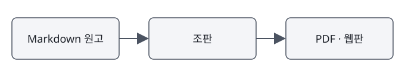

# 문서 작성 안내서

이 안내서는 Markdown 원고 하나로 PDF 와 웹판을 만드는 방법을 설명한다. 원고에 쓴 문법이 PDF 에서 어떻게 보이는지 이 문서 자체가 예시다.

## 시작하기

설치하고 첫 문서를 굽기까지의 순서를 다룬다.

### 준비할 것

다음 두 가지가 있으면 된다.

- Node.js 22 이상
- Chrome 또는 Edge. 서버에서는 `chrome-headless-shell` 을 받아 `CHROME_BIN` 에 경로를 준다.

> **참고** 브라우저는 화면 없이 실행된다. 작업 중인 창이 바뀌지 않는다.

### 첫 문서 굽기

1. 빈 폴더에서 설정과 예제 원고를 만든다.
   ```sh
   npx typeset-kit init
   ```
2. 환경을 점검한다. 실패 항목이 있으면 안내대로 고친다.
   ```sh
   npx typeset-kit doctor
   ```
3. 문서를 굽는다. 결과는 `typeset-out` 폴더에 생긴다.
   ```sh
   npx typeset-kit build --pdf --web
   ```



## 원고 쓰기

장 · 절 · 소제목과 블록을 쓰는 방법을 다룬다.

### 제목 구조

제목 단계에 따라 PDF 의 차례와 책갈피가 정해진다.

| 원고 | 뜻 | 차례 · 책갈피 |
|---|---|---|
| `#` | 문서 제목 | 표지에 쓴다 |
| `##` | 장 | 1단계 |
| `###` | 절 | 2단계 |
| `####` | 소제목 | 넣지 않는다 |

장 제목 바로 아래 첫 문단은 장 표지의 요약이 된다. 장 · 절 · 그림 번호는 자동으로 붙는다.

#### 번호를 직접 쓰지 않는 까닭

장을 옮기거나 지워도 번호를 고칠 필요가 없게 하기 위해서다.

### 목록과 코드

글머리 목록은 들여 써서 겹칠 수 있다.

- 표지
  - 문서 제목과 요약
  - 개정 이력에서 뽑은 발행 연월
- 차례
- 본문

번호 목록 안에 코드를 넣으면 그 항목 아래에 코드 상자가 생긴다. 앞의 「첫 문서 굽기」가 그 예다. 문단 안의 `코드` 는 고정폭 글꼴로 보인다.

### 콜아웃

인용문의 첫 낱말을 굵게 쓰면 콜아웃 종류가 된다.

> **참고** 알아 두면 좋은 내용을 적는다.

> **주의** 놓치면 되돌리기 어려운 내용을 적는다.

> **경고** 데이터를 잃을 수 있는 내용을 적는다.

### 그림과 표

그림은 문단에 그림 하나만 두어 넣는다. SVG 는 문서에 그대로 들어가서 그림 안 글자도 내장 글꼴로 보인다. PNG 는 긴 변이 2000px 을 넘으면 줄여서 넣는다.

표는 GFM 표 문법을 쓴다. 가운데 정렬도 쓸 수 있다.

| 출력 | 파일 | 용도 |
|:-:|---|---|
| PDF | `guide.pdf` | 인쇄 · 배포 |
| 인쇄판 HTML | `guide.html` | PDF 를 굽기 직전의 문서 |
| 웹판 | `guide.web.html` | 화면에서 읽기 |

링크는 PDF 에서도 눌린다. 예: [typeset-kit 설치 안내](https://example.com/docs/install).

## 검사하기

구운 PDF 와 원고의 글을 검사하는 방법을 다룬다.

### PDF 검사

`check` 명령은 차례 줄 수와 책갈피 수가 같은지, 링크가 맞는 쪽으로 가는지, 쪽 번호 표기가 있는지 본다.

```sh
npx typeset-kit check typeset-out/guide.pdf
```

### 글쓰기 검사

`check-writing` 명령은 과장 표현 · 비유 · 번역투 같은 금지 표현을 찾는다. 기준선을 잠가 두면 새로 늘어난 것만 실패로 알린다.

```sh
npx typeset-kit check-writing --update-baseline
npx typeset-kit check-writing --check
```

> **참고** 연결 단어가 빠진 문장이나 짝이 되는 말이 멀리 떨어진 문장은 기계로 찾기 어렵다. 사람이 다시 읽어 고친다.
