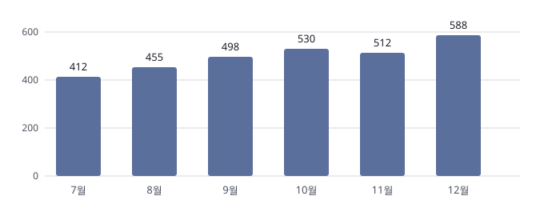
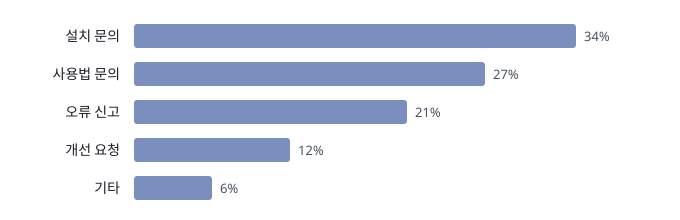
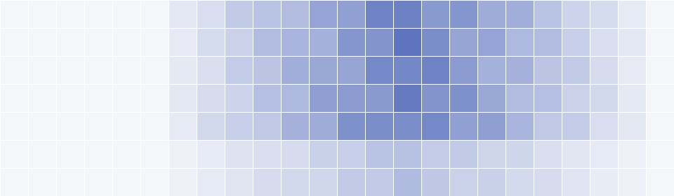

# 3분기 문의 처리 보고서

2026년 3분기에 받은 문의를 팀 · 유형 · 시간대로 나눠 정리했다. 표와 그림이 많은 문서를 어떻게 조판하는지 보이는 예제이기도 하다.

## 요약

분기 전체의 수치와 지난 분기와 달라진 점을 먼저 적는다.

### 주요 수치

3분기에 받은 문의는 2,995건이다. 2분기보다 11% 늘었다.

| 항목 | 2분기 | 3분기 | 변화 |
|---|:-:|:-:|:-:|
| 받은 문의 | 2,698건 | 2,995건 | +11% |
| 하루 안에 답한 비율 | 82% | 88% | +6%p |
| 평균 처리 시간 | 9.4시간 | 7.1시간 | -2.3시간 |
| 다시 열린 문의 | 143건 | 97건 | -46건 |

> **참고** 처리 시간은 접수부터 「확인」 단계가 끝날 때까지를 잰 값이다.

### 달라진 점

- 9월에 분류 기준을 다섯 가지로 줄였다.
- 담당 배정을 하루 두 번에서 수시로 바꿨다.
- 자주 받는 질문 40개를 안내서에 실었다.


## 월별 · 팀별 현황

달마다, 팀마다 받은 문의를 표와 그림으로 보인다.

### 월별 처리 건수

7월부터 12월 예상치까지의 처리 건수다. 11월에 조금 줄었다가 12월에 다시 늘 것으로 본다.



### 팀별 처리 건수

열이 많은 표는 그 쪽만 가로로 싣는다. 설정의 `typeset.landTables` 가 `auto` 일 때 열이 여덟 개 이상이면 가로 쪽이 된다.

| 팀 | 7월 | 8월 | 9월 | 10월 | 11월 | 12월 | 합계 | 월 평균 |
|---|:-:|:-:|:-:|:-:|:-:|:-:|:-:|:-:|
| 서울 1팀 | 60 | 67 | 74 | 81 | 88 | 95 | 465 | 78 |
| 서울 2팀 | 73 | 80 | 87 | 94 | 101 | 63 | 498 | 83 |
| 부산팀 | 86 | 93 | 100 | 62 | 69 | 76 | 486 | 81 |
| 대구팀 | 99 | 61 | 68 | 75 | 82 | 89 | 474 | 79 |
| 광주팀 | 67 | 74 | 81 | 88 | 95 | 102 | 507 | 84 |
| 대전팀 | 80 | 87 | 94 | 101 | 63 | 70 | 495 | 82 |

### 유형별 비중

설치와 사용법 문의가 전체의 61% 다. 안내서를 고치면 줄일 수 있는 문의다.



| 유형 | 건수 | 비중 | 평균 처리 시간 |
|---|:-:|:-:|:-:|
| 설치 문의 | 1,018건 | 34% | 3.2시간 |
| 사용법 문의 | 809건 | 27% | 4.5시간 |
| 오류 신고 | 629건 | 21% | 14.8시간 |
| 개선 요청 | 359건 | 12% | 9.6시간 |
| 기타 | 180건 | 6% | 5.1시간 |

### 요일 · 시간대별 접수량

가로는 0시부터 23시, 세로는 월요일부터 일요일이다. 색이 짙을수록 접수가 많다. 평일 오후 2시 앞뒤에 가장 많이 들어온다.



## 처리 내역

10월에 처리한 문의 가운데 48건을 뽑아 실었다.

### 표본 목록

행이 많은 표는 쪽을 넘겨 이어 싣는다. 이어지는 쪽에는 머리 행이 다시 나온다.

| 번호 | 접수일 | 유형 | 담당 | 상태 | 걸린 시간 | 처리 내용 |
|---|---|---|---|:-:|:-:|---|
| R-001 | 2026-10-02 | 사용법 문의 | 서울 2팀 | 완료 | 4 | 설정 값을 고쳤다. |
| R-002 | 2026-10-03 | 오류 신고 | 부산팀 | 완료 | 7 | 다음 버전에서 고친다. |
| R-003 | 2026-10-04 | 개선 요청 | 대구팀 | 처리 중 | 1 | 재현 방법을 받았다. |
| R-004 | 2026-10-05 | 설치 문의 | 광주팀 | 완료 | 4 | 글꼴을 다시 설치했다. |
| R-005 | 2026-10-06 | 사용법 문의 | 대전팀 | 완료 | 7 | 담당 팀에 넘겼다. |
| R-006 | 2026-10-07 | 오류 신고 | 서울 1팀 | 완료 | 1 | 안내서 3장을 보냈다. |
| R-007 | 2026-10-08 | 개선 요청 | 서울 2팀 | 완료 | 4 | 설정 값을 고쳤다. |
| R-008 | 2026-10-09 | 설치 문의 | 부산팀 | 처리 중 | 7 | 다음 버전에서 고친다. |
| R-009 | 2026-10-10 | 사용법 문의 | 대구팀 | 완료 | 1 | 재현 방법을 받았다. |
| R-010 | 2026-10-11 | 오류 신고 | 광주팀 | 완료 | 4 | 글꼴을 다시 설치했다. |
| R-011 | 2026-10-12 | 개선 요청 | 대전팀 | 완료 | 7 | 담당 팀에 넘겼다. |
| R-012 | 2026-10-13 | 설치 문의 | 서울 1팀 | 완료 | 1 | 안내서 3장을 보냈다. |
| R-013 | 2026-10-14 | 사용법 문의 | 서울 2팀 | 처리 중 | 4 | 설정 값을 고쳤다. |
| R-014 | 2026-10-15 | 오류 신고 | 부산팀 | 완료 | 7 | 다음 버전에서 고친다. |
| R-015 | 2026-10-16 | 개선 요청 | 대구팀 | 완료 | 1 | 재현 방법을 받았다. |
| R-016 | 2026-10-17 | 설치 문의 | 광주팀 | 완료 | 4 | 글꼴을 다시 설치했다. |
| R-017 | 2026-10-18 | 사용법 문의 | 대전팀 | 완료 | 7 | 담당 팀에 넘겼다. |
| R-018 | 2026-10-19 | 오류 신고 | 서울 1팀 | 처리 중 | 1 | 안내서 3장을 보냈다. |
| R-019 | 2026-10-20 | 개선 요청 | 서울 2팀 | 완료 | 4 | 설정 값을 고쳤다. |
| R-020 | 2026-10-21 | 설치 문의 | 부산팀 | 완료 | 7 | 다음 버전에서 고친다. |
| R-021 | 2026-10-22 | 사용법 문의 | 대구팀 | 완료 | 1 | 재현 방법을 받았다. |
| R-022 | 2026-10-23 | 오류 신고 | 광주팀 | 완료 | 4 | 글꼴을 다시 설치했다. |
| R-023 | 2026-10-24 | 개선 요청 | 대전팀 | 처리 중 | 7 | 담당 팀에 넘겼다. |
| R-024 | 2026-10-25 | 설치 문의 | 서울 1팀 | 완료 | 1 | 안내서 3장을 보냈다. |
| R-025 | 2026-10-26 | 사용법 문의 | 서울 2팀 | 완료 | 4 | 설정 값을 고쳤다. |
| R-026 | 2026-10-27 | 오류 신고 | 부산팀 | 완료 | 7 | 다음 버전에서 고친다. |
| R-027 | 2026-10-28 | 개선 요청 | 대구팀 | 완료 | 1 | 재현 방법을 받았다. |
| R-028 | 2026-10-01 | 설치 문의 | 광주팀 | 처리 중 | 4 | 글꼴을 다시 설치했다. |
| R-029 | 2026-10-02 | 사용법 문의 | 대전팀 | 완료 | 7 | 담당 팀에 넘겼다. |
| R-030 | 2026-10-03 | 오류 신고 | 서울 1팀 | 완료 | 1 | 안내서 3장을 보냈다. |
| R-031 | 2026-10-04 | 개선 요청 | 서울 2팀 | 완료 | 4 | 설정 값을 고쳤다. |
| R-032 | 2026-10-05 | 설치 문의 | 부산팀 | 완료 | 7 | 다음 버전에서 고친다. |
| R-033 | 2026-10-06 | 사용법 문의 | 대구팀 | 처리 중 | 1 | 재현 방법을 받았다. |
| R-034 | 2026-10-07 | 오류 신고 | 광주팀 | 완료 | 4 | 글꼴을 다시 설치했다. |
| R-035 | 2026-10-08 | 개선 요청 | 대전팀 | 완료 | 7 | 담당 팀에 넘겼다. |
| R-036 | 2026-10-09 | 설치 문의 | 서울 1팀 | 완료 | 1 | 안내서 3장을 보냈다. |
| R-037 | 2026-10-10 | 사용법 문의 | 서울 2팀 | 완료 | 4 | 설정 값을 고쳤다. |
| R-038 | 2026-10-11 | 오류 신고 | 부산팀 | 처리 중 | 7 | 다음 버전에서 고친다. |
| R-039 | 2026-10-12 | 개선 요청 | 대구팀 | 완료 | 1 | 재현 방법을 받았다. |
| R-040 | 2026-10-13 | 설치 문의 | 광주팀 | 완료 | 4 | 글꼴을 다시 설치했다. |
| R-041 | 2026-10-14 | 사용법 문의 | 대전팀 | 완료 | 7 | 담당 팀에 넘겼다. |
| R-042 | 2026-10-15 | 오류 신고 | 서울 1팀 | 완료 | 1 | 안내서 3장을 보냈다. |
| R-043 | 2026-10-16 | 개선 요청 | 서울 2팀 | 처리 중 | 4 | 설정 값을 고쳤다. |
| R-044 | 2026-10-17 | 설치 문의 | 부산팀 | 완료 | 7 | 다음 버전에서 고친다. |
| R-045 | 2026-10-18 | 사용법 문의 | 대구팀 | 완료 | 1 | 재현 방법을 받았다. |
| R-046 | 2026-10-19 | 오류 신고 | 광주팀 | 완료 | 4 | 글꼴을 다시 설치했다. |
| R-047 | 2026-10-20 | 개선 요청 | 대전팀 | 완료 | 7 | 담당 팀에 넘겼다. |
| R-048 | 2026-10-21 | 설치 문의 | 서울 1팀 | 처리 중 | 1 | 안내서 3장을 보냈다. |

### 다시 열린 문의

다시 열린 97건의 까닭을 나눴다.

| 까닭 | 건수 | 조치 |
|---|:-:|---|
| 답이 질문과 맞지 않았다 | 41건 | 답하기 전에 질문을 한 줄로 다시 적는다 |
| 같은 오류가 다시 났다 | 33건 | 오류 신고는 재현 방법을 받은 뒤에 닫는다 |
| 안내한 화면이 바뀌었다 | 15건 | 안내서를 버전마다 고친다 |
| 그 밖 | 8건 | 따로 조치하지 않는다 |

> **주의** 닫은 문의를 다시 열면 처리 시간이 처음부터 다시 잡힌다. 그래서 평균 처리 시간에는 넣지 않았다.

## 다음 분기 계획

4분기에 할 일을 적는다.

### 할 일

1. 설치 안내서의 운영체제별 절을 나눈다.
2. 오류 신고 양식에 재현 방법 칸을 넣는다.
   ```text
   1) 무엇을 했는가  2) 무엇을 기대했는가  3) 실제로 무엇이 나왔는가
   ```
3. 주말 접수분은 월요일 오전 10시까지 배정한다.

### 목표

| 항목 | 3분기 | 4분기 목표 |
|---|:-:|:-:|
| 하루 안에 답한 비율 | 88% | 92% |
| 평균 처리 시간 | 7.1시간 | 6시간 |
| 다시 열린 문의 | 97건 | 70건 아래 |
